Ingeniero informático y analista en logística. Construyo las herramientas que me faltan: automatizaciones, reportes y apps que ahorran horas de trabajo manual.

- **Datos y automatización:** extracción incremental desde APIs, procesos orquestados con Prefect y reportes que llegan solos por correo.
- **Dashboards en vivo** para seguir la operación de un centro de distribución minuto a minuto.
- **Herramientas para la operación:** webs para pistolas de escaneo, apps de escritorio y apps Android con Kotlin.
- **IA aplicada:** visión por computador y agentes que solo dan por cierto lo que comprobaron.

Me importa que los datos lleguen a tiempo, se puedan verificar y le sirvan a quien los usa. Y sí, todavía me gustan los gatos.

### Herramientas

### Contacto

La etiqueta de arriba se imprime sola: una GitHub Action corre <a href="scripts/etiqueta.py">este script</a> todos los días y actualiza el último despacho y las contribuciones del año.
